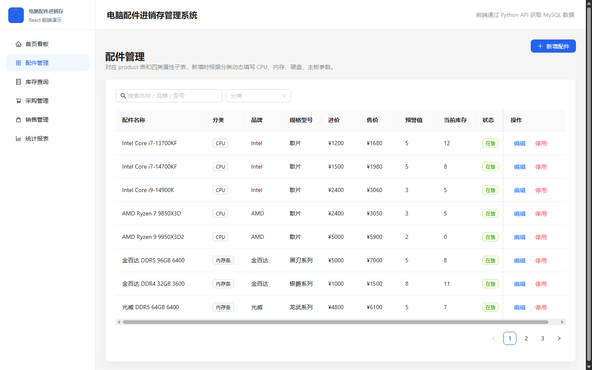
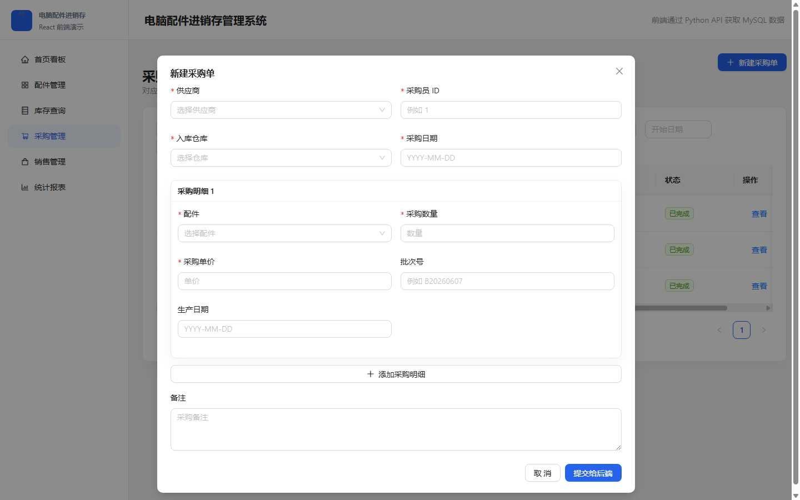
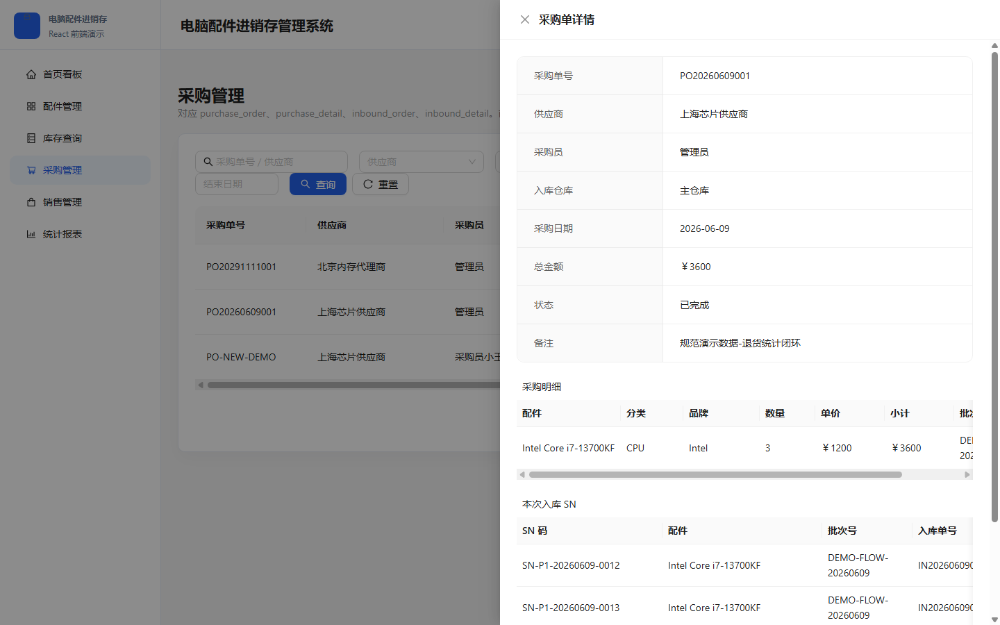
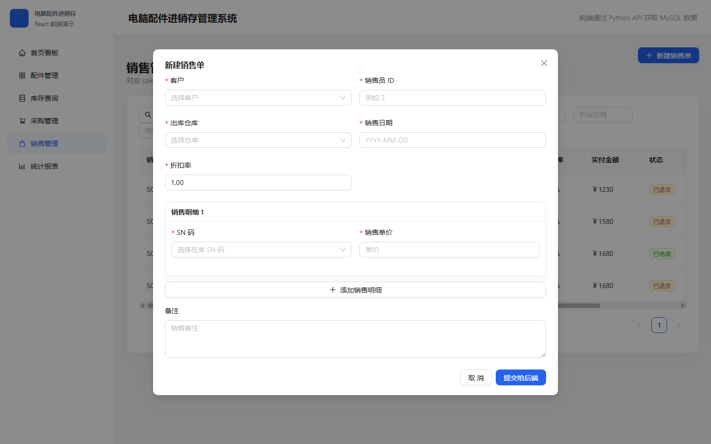
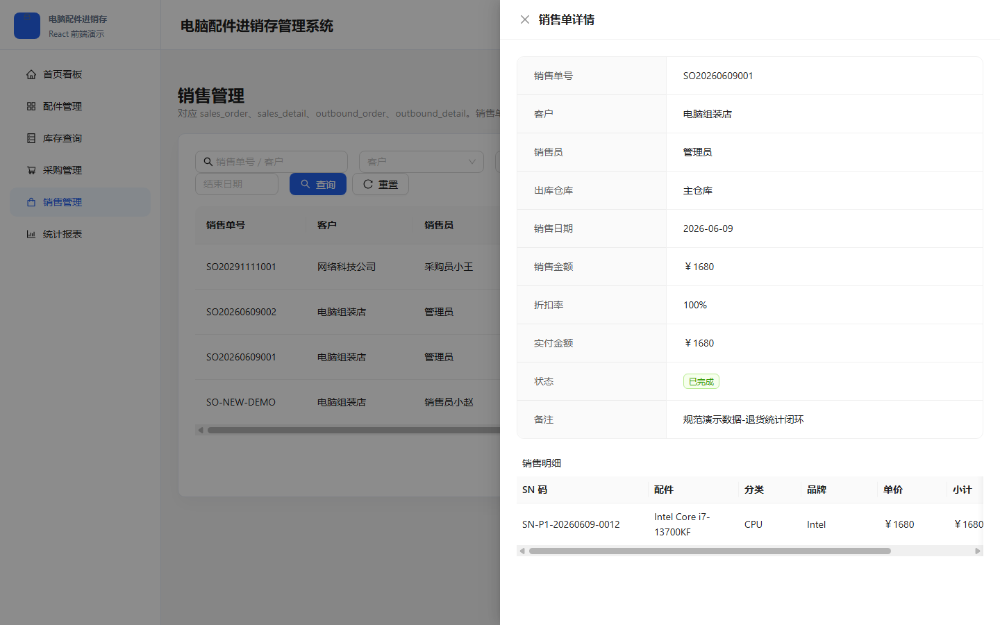

# 六、功能设计与应用

## 6.1 应用架构说明

本系统为“电脑配件进销存管理系统”，面向电脑配件采购、库存、销售和退货等业务场景。系统采用前后端分离架构，前端负责页面展示与用户交互，后端负责业务校验、事务处理和数据库访问，数据库负责持久化保存商品、库存、采购、销售、SN 码等核心数据。

### 6.1.1 开发环境

系统开发和运行环境如下：

| 类型 | 说明 |
| --- | --- |
| 操作系统 | Windows 11 |
| 前端运行环境 | Node.js、Vite 开发服务器 |
| 后端运行环境 | Python、Flask |
| 数据库 | MySQL |
| 浏览器 | Microsoft Edge / Chrome |
| 主要开发工具 | VS Code、PyCharm、Navicat 或 MySQL 客户端 |

### 6.1.2 技术栈

前端采用 React + Vite 构建单页应用，使用 Ant Design 完成页面布局、表格、表单、弹窗和抽屉详情页，使用 Axios 与后端 API 交互，使用 ECharts 展示统计图表。

后端采用 Flask 框架提供 RESTful API，通过 PyMySQL 连接 MySQL 数据库。后端主要负责采购入库、销售出库、销售退货、SN 码生成、库存更新、查询统计等业务逻辑。采购入库和销售出库等关键操作均在后端事务中完成，保证库存、SN 状态和业务单据的一致性。

数据库采用 MySQL，核心表包括 `product`、`category`、`brand`、`stock`、`product_sn`、`purchase_order`、`purchase_detail`、`inbound_order`、`inbound_detail`、`sales_order`、`sales_detail`、`outbound_order`、`outbound_detail` 等。

### 6.1.3 系统架构

系统整体架构可以分为三层：

1. 表现层：React 前端页面，负责商品管理、采购管理、销售管理、库存查询、首页看板和统计报表等功能展示。
2. 业务层：Flask 后端接口，负责接收前端 JSON 请求、执行业务校验、生成 SN 码、处理库存变化和返回查询结果。
3. 数据层：MySQL 数据库，负责保存商品信息、库存汇总、SN 单件记录、采购单、销售单、出入库记录等数据。

系统的数据流如下：

```text
用户操作页面
    ↓
React 前端提交 JSON 请求
    ↓
Flask 后端进行业务校验和事务处理
    ↓
MySQL 保存或查询业务数据
    ↓
后端返回 JSON 结果
    ↓
前端刷新表格、弹窗、图表和提示信息
```

## 6.2 功能设计

系统围绕“商品、采购、库存、销售、退货、统计”展开设计。商品信息是业务基础，采购入库会自动生成唯一 SN 码，销售出库按 SN 码选择具体实物，退货后 SN 码重新回到在库状态，库存数量同步加回。

### 6.2.1 商品信息管理

商品管理模块用于维护电脑配件基础资料，包括配件名称、分类、品牌、规格型号、进价、售价、预警值、当前库存和状态等信息。用户可以通过名称、品牌、型号和分类进行查询，并可以对商品进行新增、编辑、停用或恢复操作。

商品信息与 CPU、内存、硬盘、主板等分类属性相关联。新增或编辑商品时，系统会根据商品分类显示对应的属性字段，使不同类型配件能够记录不同的参数信息。



图 6-1 展示了商品信息管理页面。页面上方提供商品名称、品牌、型号等查询条件，下方通过表格展示配件名称、分类、品牌、规格型号、进价、售价、预警值、当前库存和状态。该页面可以帮助用户快速查看商品基础信息和库存状态。

### 6.2.2 采购单创建

采购管理模块用于完成商品采购入库。用户在新建采购单时，需要选择供应商、采购员、入库仓库、采购日期，并填写采购明细，包括配件、采购数量、采购单价、批次号和生产日期等。

采购单提交后，前端以 JSON 格式将采购单基础信息和采购明细提交给后端。需要注意的是，采购入库时前端不传入 SN 码，SN 码由后端根据商品编号、日期和流水号自动生成。后端会在一个事务中同时写入采购单、采购明细、入库单、入库明细、SN 码记录，并更新库存数量。



图 6-2 展示了新建采购单窗口。该窗口支持填写采购基本信息和多条采购明细，为后续生成入库记录和 SN 单件追踪记录提供数据基础。

### 6.2.3 采购单查看

采购单创建完成后，可以在采购管理页面查看采购单详情。详情页展示采购单号、供应商、采购员、入库仓库、采购日期、总金额、状态和备注，并展示采购明细。

对于通过当前系统创建的规范采购单，详情页还会展示“本次入库 SN”。该区域显示本次采购入库生成的 SN 码、对应配件、批次号和入库单号，体现了采购入库和 SN 单件追踪之间的关联。



图 6-3 展示了采购单详情。可以看到采购单基础信息、采购明细以及本次入库生成的 SN 码。通过该页面，用户能够确认某次采购入库具体生成了哪些单件商品。

### 6.2.4 销售单创建

销售管理模块用于完成商品销售出库。销售单创建时，用户需要选择客户、销售员、出库仓库、销售日期和折扣率，并在销售明细中选择具体 SN 码和销售单价。

与采购入库不同，销售出库时前端需要传入 SN 码。原因是销售业务必须明确卖出的是哪一个具体实物。后端收到销售请求后，会校验 SN 是否存在、是否属于当前仓库、是否处于在库状态，以及商品是否仍然在售。校验通过后，后端会写入销售单、销售明细、出库单和出库明细，将 SN 状态改为“已售”，并扣减库存数量。



图 6-4 展示了新建销售单窗口。用户可以按仓库选择在库 SN 码，从而保证销售出库能够追踪到具体商品实物。

### 6.2.5 销售单查看

销售单详情用于查看销售业务的完整信息，包括销售单号、客户、销售员、出库仓库、销售日期、销售金额、折扣率、实付金额、状态和备注。销售明细中展示本次销售涉及的 SN 码、配件、分类、品牌、单价、小计和 SN 状态。

系统还支持整单退货。退货后，销售单状态会变为“已退货”，对应 SN 码重新变为“在库”，库存数量同步加回。这样既保留了销售历史，又能反映商品当前可再次销售的状态。



图 6-5 展示了销售单详情。销售明细中可以看到本次销售对应的具体 SN 码，说明系统不仅记录销售金额，也能追踪到单件商品。

## 6.3 应用特点

本系统的主要特点如下：

1. 采用前后端分离结构，前端页面清晰，后端接口职责明确。
2. 采购入库由后端自动生成唯一 SN 码，避免前端或人工录入造成重复。
3. 销售出库按 SN 码选择具体实物，保证单件商品可追踪。
4. 退货后 SN 码回到在库状态，库存数量同步恢复，符合模拟业务流程。
5. 首页看板和统计报表区分有效销售与退货金额，避免销售数据虚高。
6. 查询功能覆盖商品、采购、销售、库存和 SN 单件追踪，便于演示和答辩说明。

## 6.4 小结

通过以上功能设计，系统实现了电脑配件进销存的核心业务流程。商品信息管理提供基础数据，采购入库生成 SN 码并增加库存，销售出库按 SN 码扣减库存，退货业务将 SN 重新转为在库状态。配合首页看板和统计报表，系统能够较完整地展示电脑配件从采购、入库、库存管理、销售到退货的业务闭环。
